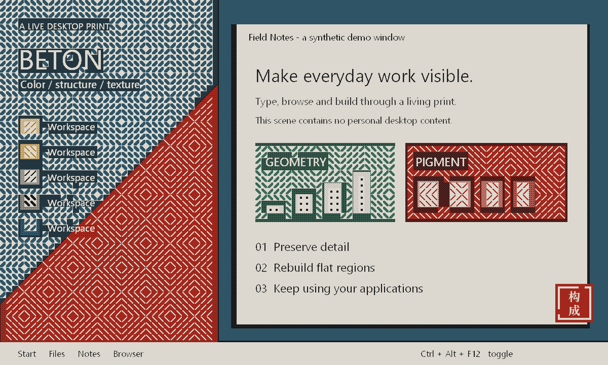
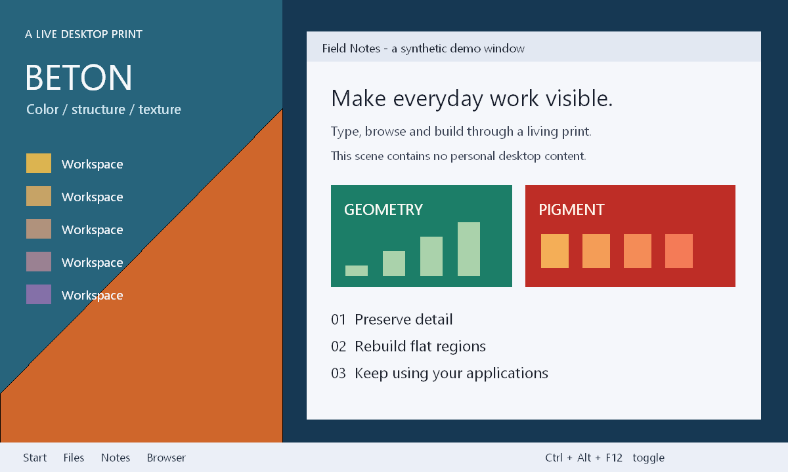

# BETON LENS

English | [简体中文](README.zh-CN.md)

**Turn your Windows desktop into a living constructivist print.**

> **Just for fun — an experimental desktop toy.** This project exists to mess around with visual styles and GPU rendering. Expect rough edges; it makes no promises about everyday usability or production reliability.

Beton Lens captures your primary display, runs it through two GPU shader passes, and draws the result in a click-through overlay. Your apps keep working underneath, while the desktop becomes paper, ink, a handful of pigments, and geometric hatching.

  

## A desktop, reprinted



<details>
<summary>Show the original demo scene</summary>



</details>

These images use the project's actual two-pass HLSL shaders to render a synthetic scene offline. They demonstrate the visual effect, not live capture performance or latency. No personal desktop content is included.

## What it does

- **Reprints detail:** cells with higher luminance variation retain per-pixel detail, using three-tone pigment mapping and 4×4 Bayer ordered dithering. This is a statistical heuristic, not OCR.
- **Rebuilds flat regions:** backgrounds and large color fields become dots, diagonal strokes and alternating woven patterns, with fine gaps between cells.
- **Limits the palette:** concrete-colored paper, ink, gray, rust red, ochre, slate blue and verdigris replace the original colors.
- **Adds a carved-print feel:** red regions use pale strokes on a red ground; a small “构成” seal sits near the bottom right.
- **Lets clicks through:** the overlay passes mouse input to the windows underneath. Global hotkeys control the effect.

The GPU version needs no driver installation and does not change your system theme or display color settings. Exiting removes its overlay.

## Build and run

Requirements:

- Windows 10 version 2004 or newer / Windows 11 recommended. The overlay relies on `WDA_EXCLUDEFROMCAPTURE` to exclude itself from capture.
- A GPU supporting Direct3D feature level 11.0 and working DXGI Desktop Duplication.
- Visual Studio 2022 or Build Tools with **Desktop development with C++** and a Windows SDK.

```bat
build-gpu.cmd
BetonLensGPU.exe
```

The build script finds MSVC through `vswhere`, or uses an already configured x64 Native Tools prompt. No third-party libraries or shader packs are required.

### Controls

The GPU version currently has **no tray icon**. Remember the exit shortcut before starting it.

| Shortcut | Action |
|---|---|
| `Ctrl+Alt+F12` | Toggle the effect |
| `Ctrl+Alt+F11` | Cycle opacity: 100% → 70% → 45% |
| `Ctrl+Alt+F10` | Cycle cell size: 8 → 12 → 18 px |
| `Ctrl+Alt+Shift+F12` | Exit |

Shortcuts may conflict with other apps; there is no hotkey editor yet.

## How it works

```text
DXGI Desktop Duplication
          ↓ desktop texture stays in VRAM
Pass 1: per-cell mean color and luminance variation
          ↓
Pass 2: pigment mapping, dithering, geometry and seal
          ↓
DirectComposition + flip-model swap chain
          ↓
Click-through desktop overlay
```

The overlay is excluded from screen capture to avoid capturing its own output repeatedly. As a consequence, ordinary screenshots and desktop recordings usually do not include the effect.

To export the shader output, run:

```bat
BetonLensGPU.exe --snapshot
```

After the tenth processed frame, it writes `lens-gpu-capture.bmp` and `lens-gpu-frame.bmp` beside the executable. Keep something moving on the desktop to advance the frame count. The app continues running after export.

## Performance notes

The original prototype notes reported about 143 draws/second on an AMD 780M at 1920×1080 with a 144 Hz display. This is a development observation, not a reproducible benchmark or a guarantee for other machines.

The log's `CPU submit` measures CPU-side submission time. `desktop-present -> lens-present` measures the interval from the desktop presentation timestamp to submission of the filtered frame; it is **not complete end-to-end display latency**. GPU execution, desktop composition and display scanout also matter. Fewer draws on a static desktop are expected.

## Rough edges

- The GPU version covers only the primary display. Multiple displays, HDR, rotation and resolution changes are not thoroughly tested.
- Protected video may appear black. Capture may be interrupted by the lock screen or secure desktop.
- Hybrid-GPU laptops need a device that can duplicate the screen output; the app tries multiple adapters.
- Strong stylization loses colors and details. Small text is not guaranteed to remain readable.
- The seal uses a system font; its appearance may vary when Noto Serif SC is unavailable.
- There is no full settings panel, installer or auto-updater. This is still a toy prototype.

## Source layout

```text
BetonLensGPU.cpp     GPU version, including embedded HLSL
build-gpu.cmd       MSVC build script
legacy/
  BetonLens.cs      Original GDI / CPU implementation
  BetonVeil.cs      Earlier color-matrix and grain experiment
  build.cmd         Build both C# experiments
README.zh-CN.md     Chinese documentation
docs/images/        Synthetic input and actual shader output
```

All three implementations are included. Run `legacy\build.cmd` to build the C# experiments with the .NET Framework compiler included with Windows. The early `BetonVeil` experiment uses the Windows Magnification API; if it is forcibly terminated and the color effect remains, relaunch it and exit normally with `Ctrl+Alt+Shift+F12`, or sign out.

## Playing with it

Feel free to fork it, change the pigments, invent another hatch pattern, or make something stranger. Issues with your Windows version, GPU model and reproduction steps are welcome. Check logs and screenshots for personal information before sharing them.

Possible experiments include multiple displays, a parameter panel, custom palettes and textures, and better text readability.

## License

[MIT](LICENSE) © 2026 Ssttri
