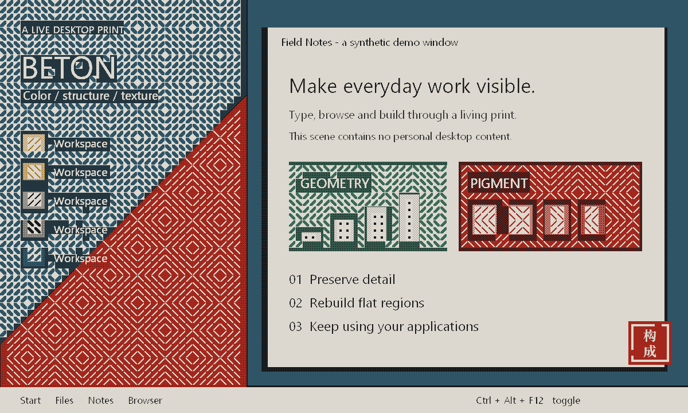
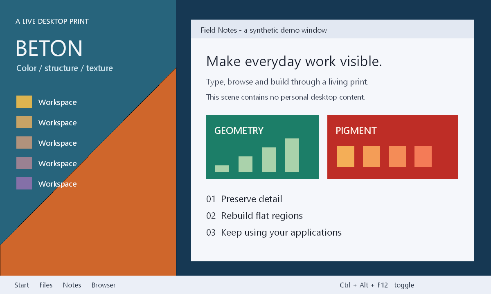

# BETON LENS · 构成主义桌面镜头

[English](README.md) | 简体中文

> **纯属整活，用来玩和做视觉实验。** 这是一个实验性的桌面玩具，不承诺日常使用体验或生产环境稳定性。

**把正在使用的 Windows 桌面，实时重印成一张会动的版画。**

Beton Lens 是一个实验性的桌面视觉滤镜。它抓取主显示器画面，在 GPU 上处理，再通过鼠标点击可穿透的覆盖层显示。窗口、网页和应用继续正常使用，画面被统一成纸色、墨色和几种颜料色。

Real-time constructivist desktop stylization for Windows, powered by DirectX 11. A click-through overlay turns your desktop into a limited-palette print with ordered dithering, geometric hatching and a carved red seal.

  

## 看起来是什么样



<details>
<summary>查看处理前的演示画面</summary>



</details>

上图使用项目原有的两遍 HLSL 着色器，对专门绘制的演示画面离线渲染。它展示滤镜效果，不是实时桌面截图，也不用于证明帧率或延迟。

## 它会做什么

- **保留内容细节**：根据每格的明暗离散度识别文字、图标和边缘较多的区域，逐像素进行三调重印与 4×4 Bayer 有序抖动。这是统计规则，不是 OCR。
- **重画平坦区域**：把背景和大色块转换成点、斜线和交替方向的编织纹，格子之间保留细缝。
- **统一颜料**：使用混凝土纸色、墨、灰，以及锈红、赭黄、石板蓝、铜绿等有限色调。
- **加入篆刻感**：红色区域使用红底浅色线条，右下角留一方“构成”印章。
- **继续操作桌面**：覆盖层不接收鼠标点击，可以用全局快捷键切换效果、透明度和格子大小。

不需要安装驱动。GPU 版退出时会移除覆盖层，不修改系统主题或显示器颜色设置。

## 快速开始

从源码构建后，运行 `BetonLensGPU.exe`。GPU 版目前没有托盘图标，请先记住退出快捷键。

| 快捷键 | 功能 |
|---|---|
| `Ctrl+Alt+F12` | 开关效果 |
| `Ctrl+Alt+F11` | 不透明度：100% → 70% → 45% |
| `Ctrl+Alt+F10` | 格子尺寸：8 → 12 → 18 px |
| `Ctrl+Alt+Shift+F12` | 退出 |

快捷键可能与其他软件冲突，目前没有自定义快捷键界面。

## 环境与构建

- 建议 Windows 10 2004 或更新版本 / Windows 11；依赖 `WDA_EXCLUDEFROMCAPTURE` 排除自身捕获。
- 支持 Direct3D feature level 11.0 的 GPU，以及可用的 DXGI Desktop Duplication。
- 构建需要 Visual Studio 2022 或 Build Tools，“使用 C++ 的桌面开发”组件和 Windows SDK。

```bat
build-gpu.cmd
BetonLensGPU.exe
```

构建脚本通过 `vswhere` 查找 MSVC，也支持已配置好编译器的 x64 Native Tools 命令提示符。程序没有第三方运行库或着色器包依赖。

## 渲染流程

```text
DXGI Desktop Duplication
          ↓ 桌面纹理留在显存
第一遍 HLSL：每格平均色与明暗离散度
          ↓
第二遍 HLSL：有限色、抖动、几何纹理与印章
          ↓
DirectComposition + flip-model swap chain
          ↓
可点击穿透的桌面覆盖层
```

覆盖窗口被排除在屏幕捕获之外，避免反复抓取自己的输出。其副作用是普通截图或桌面录屏通常看不到滤镜层。

如需导出真实滤镜结果，可以从命令行运行：

```bat
BetonLensGPU.exe --snapshot
```

程序处理到第 10 帧后，会在可执行文件旁写出 `lens-gpu-capture.bmp` 和 `lens-gpu-frame.bmp`。请让桌面有少量变化以推进帧数；导出后程序继续运行。

## 性能说明

原型开发记录中，在 AMD 780M、1920×1080、144 Hz 环境下曾观察到约 143 次绘制/秒。这个数字依赖桌面更新、硬件和工作负载，不保证在其他设备上复现。

日志中的 `CPU submit` 是 CPU 侧提交耗时；`desktop-present -> lens-present` 是从桌面呈现时间戳到提交滤镜帧的时间差，**不包含屏幕实际发光的完整端到端延迟**。GPU 执行、桌面合成和显示扫描也会影响体感延迟。静态桌面下绘制次数降低是预期行为。

## 当前限制

- GPU 版只覆盖主显示器；多屏、HDR、显示旋转与分辨率切换尚未充分验证。
- DRM 内容可能为黑块，锁屏和安全桌面期间捕获可能中断。
- 混合显卡设备需要找到能复制屏幕输出的 GPU；程序会尝试多个适配器。
- 强风格处理会损失部分颜色与细节，小字号文字不保证始终清晰。
- 印章使用系统字体；没有安装 Noto Serif SC 时，字形可能因系统回退而不同。
- 这是早期原型，尚无完整的设置界面、自动更新或安装程序。

## 仓库结构

```text
BetonLensGPU.cpp     GPU 版及内嵌 HLSL
build-gpu.cmd       MSVC 构建脚本
legacy/             C# CPU 版与早期颜色矩阵版
docs/images/        干净的演示输入和实际着色器输出
```

`legacy/` 中保留了 GDI 抓屏的 CPU 版，以及使用 Windows Magnification API 的 `BetonVeil`。它们用于记录实验过程。早期调色版如果被强制结束后颜色没有恢复，可重新运行并用退出快捷键正常关闭，或注销会话。

## 反馈与后续方向

欢迎通过 Issues 反馈显卡型号、Windows 版本、分辨率和复现步骤。分享日志或截图前请先检查个人信息。

值得继续探索的方向：多显示器、参数面板、自定义颜料与纹理、更稳健的显示模式切换处理，以及不同内容下的文字可读性。

## License

[MIT](LICENSE) © 2026 Ssttri

